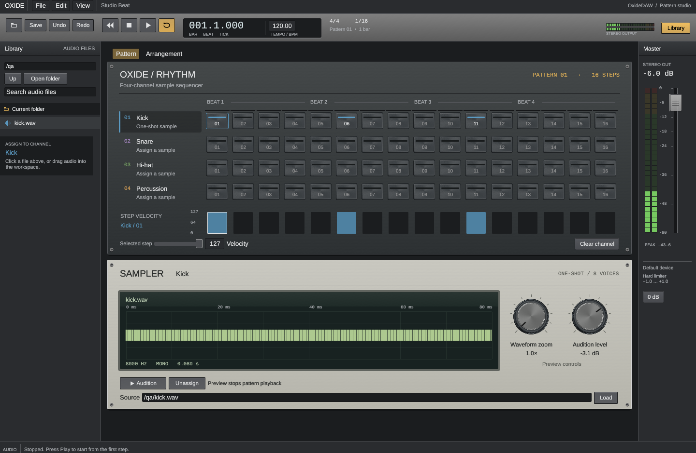

# OxideDAW

> A modern, blazing-fast, open-source Digital Audio Workstation (DAW) for all genres of music production, sound design, and audio engineering, written in Rust with native Model Context Protocol (MCP) integration.

---

## Overview

### Implementation status

This repository is an early prototype. The CLI now contains device enumeration
and one-shot audio playback with volume control. A four-track, 16-step sequencer
now drives a sampler with eight voices per track, velocity, stereo mixing and
master volume. The CLI can loop a preset drum pattern from four sample files, save a versioned
JSON project, inspect it and play it again after reopening.
The line-oriented project editor supports validated command batches and undo/redo.
The renderer supports pause, stop, step seeking, live tempo changes and one-shot tail playback.
Pattern playback accepts transport commands; Enter quits.
A native studio workspace provides a four-bar pattern monitor, a sample browser,
step and velocity editing, a sampler with rotary controls, stereo peak meters,
transport, master fader, project storage and undo/redo.
The workspace builds and 40 tests pass. Playback on real audio hardware remains
unverified. The DAW features
described below are planned, unless explicitly marked complete.

First development target: Linux. Install a Rust toolchain and the ALSA development
package (`libasound2-dev` on Debian/Ubuntu or `alsa-lib-devel` on Fedora).

```sh
cargo test --workspace
cargo run -p oxide-app -- devices
cargo run -p oxide-app -- play /path/to/sample.wav 0.5
# Loop the built-in beat (kick, snare, hi-hat, percussion), BPM and master volume:
cargo run -p oxide-app -- pattern kick.wav snare.wav hat.wav perc.wav 120 0.5
# Optional exact output device name as the final argument:
cargo run -p oxide-app -- play /path/to/sample.wav 0.5 "device name"
```

`play` runs once and then outputs silence; `pattern` loops until Enter.
Both commands accept an exact output device name as their final optional argument.
The demo triggers kick on steps 1/5/9/13, snare on 5/13, hi-hat on odd steps,
and percussion on step 15. Use `project-edit` to change a saved beat;
use `bpm N` during pattern playback to change its tempo.
Overlapping hits use eight voices per track, replacing the oldest hit when full.
The summed output is hard-clipped to the range -1..1; reduce volume if it distorts.
The prototype decodes the entire file into memory before starting playback,
supports mono/stereo input, and uses linear interpolation when sample rates differ.
It uses the default CPAL host and device configuration; dedicated PipeWire/JACK
integration, latency controls, and production-quality resampling remain planned.

During `pattern` or `project-play`, enter one control per line:

```text
pause
seek 8
bpm 137.25
play
stop
play
quit
```

`seek` selects step 0..15, cuts existing sample tails, and preserves play/pause.
The destination triggers when playback resumes. `bpm` accepts 1..999 and preserves
musical position; sounding samples keep their playback rate. `pause` freezes
sample tails, and `stop` clears them and resets to step 0. Enter, `quit`, or EOF
ends playback. These controls affect this playback session; they do not save changes
to the project. Invalid commands are reported without stopping subsequent input;
the CLI exits with code 1 if any command was rejected.

Controls pass through a bounded FIFO of 64 messages and take effect at the next
audio callback. A full queue rejects the new control with a retry message.

### Desktop workspace

```sh
cargo run -p oxide-app --features gui -- gui
cargo run -p oxide-app --features gui -- gui beat.oxide.json
```

Select a channel and choose a WAV, FLAC or MP3 from the browser, or drop a file
onto the window. Click steps to build the beat; right-click a step to select it
for velocity editing. Space plays/pauses, Ctrl+S saves, Ctrl+Z undoes and
Ctrl+Shift+Z redoes. The native interface uses eframe/egui with OpenGL on Linux
X11 or Wayland; CLI playback can still be built without the `gui` feature.
See [workspace controls, design and runtime requirements](docs/interface.md).



### Saving and reopening a beat

```sh
# Keep samples alongside the project (or in its subdirectories) for portability.
cargo run -p oxide-app -- project-new beat.oxide.json kick.wav snare.wav hat.wav perc.wav 137 0.3
cargo run -p oxide-app -- project-info beat.oxide.json
cargo run -p oxide-app -- project-play beat.oxide.json
# Optional output device:
cargo run -p oxide-app -- project-play beat.oxide.json "device name"
```

`project-new` saves the built-in beat and refuses to overwrite an existing file.
The JSON stores track IDs/names, sample references, BPM, target sample rate,
master volume and all 64 step velocities. Relative sample paths resolve against
the project directory; external samples are stored as absolute paths. Audio is
referenced, so move the media together with the JSON to keep a portable project.
Missing media is reported by `project-info` and does not prevent document loading.
`project-play` reports the affected track and file before opening an audio stream.
See [the project format](docs/project-format.md) for editing and storage details.

### Exporting a beat

```sh
cargo run -p oxide-app -- project-export beat.oxide.json beat.wav
```

Export renders one 16-step pattern plus any ringing sample tails to stereo
16-bit PCM at the project's sample rate. It uses the saved BPM, step velocities
and master volume and runs without an audio device. Unassigned tracks are
silent. Missing assigned media causes an error. The destination must be new.

### Editing a beat

Run `cargo run -p oxide-app -- project-edit beat.oxide.json`, then enter one
command or JSON array per line. An array applies atomically and undoes as one action:

```text
{"command":"set_step","track_id":1,"step":0,"velocity":100}
[{"command":"set_bpm","bpm":128},{"command":"set_master_volume","volume":0.4}]
{"command":"set_sample","track_id":2,"sample":"samples/snare.wav"}
undo
redo
show
save
quit
```

Track selectors are stable IDs shown by `project-info`; steps are zero-indexed
(0..15), and velocity 0 disables a step. Sample references resolve against the
project directory and may point to missing files; use `null` to unassign a sample.
Only `save` writes the document. `quit` or EOF discards unsaved changes.
History holds up to 128 actions in memory and is cleared when the editor closes.
Input may be piped from a script. Rejected lines report errors and leave state
and history unchanged; later lines still run, and the process exits with code 1
if any action failed, even if a subsequent `save` succeeded.

**OxideDAW** is an independent, general-purpose, cross-platform Digital Audio Workstation built for musicians, producers, sound designers, and composers on Windows and Linux. 

Whether you are writing orchestral arrangements, recording live acoustic instruments, producing beats, scoring games, or mixing multi-track audio, OxideDAW combines the high-speed pattern-and-clip workflow loved by modern producers with deep multi-track recording and mixing capabilities.

By leveraging Rust, OxideDAW delivers deterministic real-time audio safety without garbage collection pauses, ultra-low latency audio processing on both Windows (WASAPI) and Linux (PipeWire / JACK / ALSA), and a lightweight, GPU-accelerated interface.

In addition, OxideDAW features a native **Model Context Protocol (MCP)** server embedded directly into the application, turning AI assistants into interactive studio co-producers capable of manipulating MIDI sequences, arrangements, audio routing, and mixer states via structured protocol messages.

---

## Core Pillars

1. **Deterministic Real-Time Audio Engine**
   - Engineered in Rust for high reliability and memory safety without GC-induced audio glitches or buffer dropouts.
   - Lock-free, wait-free ring buffers between the real-time audio thread and the UI/worker threads.
   - Low-latency native audio drivers: WASAPI on Windows, and PipeWire / JACK / ALSA on Linux.

2. **Versatile Workflow for Any Musical Genre**
   - **Multi-Track Audio Recording & Editing:** Seamless tracking for vocals, guitars, synths, and external hardware.
   - **Next-Gen Piano Roll:** Polyphonic MIDI editing, micro-tuning, chord generation, scale quantization, slide/glide notes, and per-note velocity/expression.
   - **Pattern & Step Sequencer:** Rapid percussion programming, polyrhythms, and clip-based arranging.
   - **Channel Rack & Sampler:** High-quality multi-format audio playback, time-stretching, pitch shifting, and ADSR modulation.

3. **Open Plugin Architecture & Plugin Creation Ecosystem**
   - **CLAP & VST3 Hosting:** Seamlessly load your favorite third-party virtual instruments and VST3/CLAP effects.
   - **Custom Plugin SDK (`oxide-plugin-sdk`):** A first-class Rust and WebAssembly (WASM) SDK allowing developers and sound designers to build custom native synths, samplers, and audio effects with hot-reloading.
   - **Visual Modular Node Environment (Patcher Rack):** Wire up multiple plugins, split frequency bands, route MIDI, and create complex custom composite instruments and multi-effect chains on an infinite visual canvas.
   - **Live Scripting Engine:** Write lightweight scripts (WASM / Rhai / Lua) for algorithmic MIDI generation, custom arpeggiators, and generative sequencing in real time.

4. **Embedded Model Context Protocol (MCP) Engine**
   - Built-in MCP server communicating over standard I/O or local WebSockets.
   - Enables connected AI agents (Claude, Cursor, local LLMs) to query project state, generate MIDI parts, configure mixer routing, and assist with sound design and orchestration programmatically.

---

## System Architecture

OxideDAW is structured as a modular Cargo workspace:

```
OxideDAW/
├── crates/
│   ├── oxide-core/        # Project model, timeline graph, track state, serialization
│   ├── oxide-audio/       # Real-time audio engine, driver abstractions (WASAPI, PipeWire)
│   ├── oxide-dsp/         # Native DSP nodes: filters, envelopes, basic oscillators, samplers
│   ├── oxide-midi/        # MIDI events, Piano Roll data structures, quantization
│   ├── oxide-plugin-sdk/  # SDK and API for creating custom native / WASM instruments & effects
│   ├── oxide-plugins/     # CLAP and VST3 host implementation & Patcher modular graph
│   ├── oxide-mcp/         # MCP server protocol implementation & tool handlers
│   ├── oxide-ui/          # GPU-rendered interface (wgpu + egui / iced)
│   └── oxide-app/         # Main desktop application binary and entry point
├── assets/                # Stock sounds, factory presets, and UI assets
└── README.md
```

---

## MCP Tool Interfaces (AI Co-Producer)

The embedded MCP interface exposes tools that allow AI assistants to manipulate musical data directly inside the project:

- `generate_drum_pattern`: Program kick, snare, clap, and hi-hat triggers onto a target pattern grid with custom velocity dynamics and swing.
- `create_chord_progression`: Insert diatonic or modal chord voicings into the Piano Roll based on scale, root key, and rhythmic pacing.
- `humanize_notes`: Apply non-destructive micro-timing nudges and velocity variations to humanize quantized MIDI clips.
- `route_mixer_channel`: Configure channel gains, pans, sends, and sidechain compression routings across mixer tracks.
- `get_project_summary`: Provide the agent with context regarding BPM, active tracks, key signatures, and time signatures.

---

## Development Roadmap

Implementation status and development roadmap (Russian): [DEVELOPMENT_PLAN.md](DEVELOPMENT_PLAN.md). This document records the inspected implementation state, MVP scope, and next steps; the phases below describe the broader vision.

### Phase 1: Engine Foundation
- [x] Initialize Cargo workspace structure.
- [ ] Implement audio device abstraction via `cpal` (WASAPI & PipeWire).
- [ ] Create lock-free ring-buffer communication between audio thread and main thread.
- [ ] Build basic multi-channel playback clock (BPM, transport start/stop/seek).

### Phase 2: Sampler & Step Sequencer
- [ ] Implement audio sample decoder (WAV, FLAC, MP3, OGG) via `symphonia`.
- [ ] Build single-shot sampler voice with pitch transposition and volume envelope.
- [x] Construct the 16-step grid sequencer state and playback dispatcher (CLI, four tracks).

### Phase 3: Graphical Interface MVP
- [x] Initialize a native GPU-rendered UI window using eframe/egui and OpenGL.
- [x] Render an interactive step sequencer grid with an audio-driven playback cursor.
- [x] Implement drag-and-drop sample loading into the selected sampler track.

### Phase 4: Piano Roll & MIDI Subsystem
- [ ] Create MIDI event sequence model (note on, note off, pitch bend, velocity).
- [ ] Build Piano Roll editor with zoom, note creation, resizing, and snapping to musical grid.
- [ ] Implement polyphonic MIDI playback routing to virtual instruments.

### Phase 5: Mixer & Built-in FX
- [ ] Build multi-channel audio mixer with volume faders, panning, and solo/mute toggles.
- [ ] Implement native DSP effects: Parametric Equalizer, Stereo Delay, Reverb, Compressor.
- [ ] Add sidechain ducking support between mixer channels.

### Phase 6: Plugin Ecosystem & Modular Patcher
- [ ] Integrate CLAP & VST3 plugin hosting layer for external instruments and effects.
- [ ] Design and implement `oxide-plugin-sdk` for authoring custom native and WASM plugins.
- [ ] Build visual modular node environment ("Patcher") to chain, split, and modulate multiple plugins visually.
- [ ] Implement lightweight scripting runtime for generative MIDI and custom algorithmic effects.

### Phase 7: Model Context Protocol (MCP) Integration
- [ ] Embed lightweight JSON-RPC / MCP server within the daemon/app.
- [ ] Expose sequence, mixer, and project manipulation tools to AI agents.
- [ ] Test end-to-end workflows with external agents (e.g. Claude Desktop, Cursor).

---

## Target Platforms

- **Windows 10 / 11** (x86_64) via WASAPI low-latency audio.
- **Linux** (x86_64, aarch64) via PipeWire, JACK, and ALSA.

---

## License

This project is licensed under the Apache 2.0 License or MIT License at your option.
