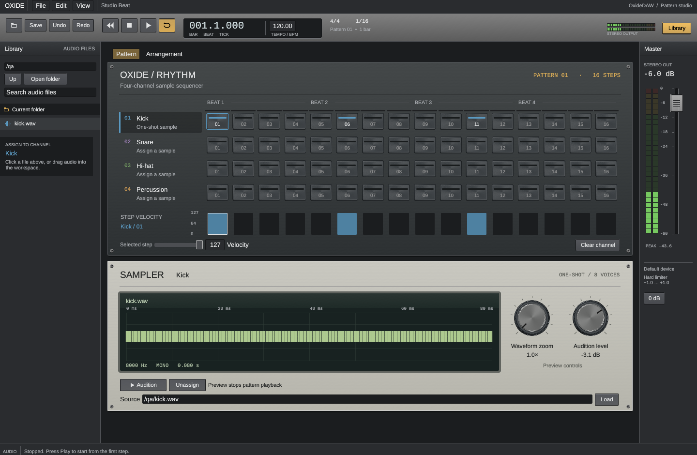

# Pattern studio

The native workspace combines a time-based pattern monitor, a four-channel step
sequencer, a sample library, an instrument-style sampler panel and stereo output.



## Visual language

The material treatment follows the studio controls in
[GarageBand](https://support.apple.com/guide/garageband/welcome/mac): a metal
transport panel, an inset musical-position display, shaded fader caps, illuminated
step buttons and rotary controls with directional lighting. The sampler cabinet
has narrow wooden side pieces and recessed waveform glass. These surfaces are
painted as native geometry; the interface does not depend on image backgrounds.

The time ruler and aligned track headers take structural reference from
[Ableton Live](https://www.ableton.com/en/manual/arrangement-view/).
The grouped step rows follow the pattern workflow of
[FL Studio's Channel Rack](https://www.image-line.com/fl-studio-learning-content/fl-studio-online-manual/html/channelrack.htm).
Track color connects each waveform, its step row and the selected sampler.

| Role | Color |
| --- | --- |
| Workspace | `#27282A` |
| Panels | `#353639` |
| Control surface | `#4C4E52` |
| Text | `#E2E3E4` |
| Secondary text | `#A4A7AB` |
| Brass accent | `#D8AB56` |

Track colors are blue, mauve, green and amber. Green/yellow/red meter segments
represent measured signal levels. Buttons have separate raised, pressed, selected,
hover and keyboard-focus states. The bundled Liberation Sans and Liberation Mono
fonts keep names and musical values compact; their font license is included in
`crates/oxide-ui/assets/fonts/LICENSE`.

## Working areas

**Transport.** Open/save, undo/redo, return to the first step, stop, play/pause,
editable tempo, bar/beat/tick position and stereo output meters. File and Edit
menus also provide project actions; Library toggles the browser.

**Pattern timeline.** Four repetitions of the current one-bar pattern, with a
bar/beat/subdivision ruler and sample envelopes at their trigger positions.
Click a waveform region to select its channel and seek to a step. The cursor
reads musical position from the audio callback. Arrangement editing remains
future work.

**Step sequencer.** Click a pad to toggle velocity 0/100; right-click to select
it without changing it. The selected step's velocity is available through the
slider and the sampler's rotary control. The small bar beneath each active pad
shows its velocity. Clear channel applies all sixteen edits as one undo action.
The triangle on a channel auditions its sample.

**Sampler.** Real sample waveform, duration, channel count, sample rate, zoom,
source path, load/unassign and audition controls. Drag either rotary control
vertically to change step velocity or master output; arrow keys make fine changes.
Audition stops pattern playback and plays the selected file once. Stop also
ends audition playback.

**Master.** A logarithmic fader with a −60..0 dB scale and separate left/right
output meters. Track meters show channel peaks before master gain. Peak values
are measured in the audio callback and retained across callback chunks until the
UI reads them; the display uses a short decay. The 0 dB button sets unity gain.

## Files and editing

Select a channel, then click a WAV, FLAC or MP3 in the library to assign it.
Dropping audio on the window assigns it to the selected channel. The library
supports folder navigation, filtering and a project-media list.

Pattern, tempo and gain edits reach playback through a single validated,
bounded state message. Slider and rotary drags commit on release, preserving
one undo action per gesture. Tempo text commits on Enter or loss of focus.
Assigning a new sample stops pattern playback while the file is decoded.
Unassigned channels are silent; unavailable assigned samples can be replaced
through the library or source-path control.

Open and Save use explicit file paths. New files refuse to overwrite existing
files. Saving elsewhere rebases relative media references while preserving the
meaning of undo snapshots. Closing a changed project opens a save/discard dialog;
opening another project shows an unsaved-changes warning.

Keyboard: Space plays/pauses when no text control is editing; Ctrl+S saves,
Ctrl+Z undoes, Ctrl+Shift+Z redoes, and Ctrl+Q closes. These use Command on macOS.
Smaller windows scroll the workspace; the minimum size is 1040×740.

## Arrangement

Use the **Arrangement** tab above the step sequencer to edit and loop the
saved bar order. **+ Pattern** inserts a bar that follows edits to the main
pattern. **+ Variation** captures the current pattern as an independent bar.
**+ Rest** adds a bar with no new hits.

Select a bar to move, replace or remove it. Double-click a bar to seek while
the transport is active. The highlighted bar follows playback. Switching
tabs or changing the bar order stops playback. Press Play to hear the new
sequence. Main-pattern, tempo and volume edits can still update a running
session. The whole arrangement is saved with the project and each bar edit
is one undo action.

## Run and verification

```sh
cargo run -p oxide-app --features gui -- gui
cargo run -p oxide-app --features gui -- gui /path/to/beat.oxide.json
cargo test --workspace --all-features
cargo clippy --workspace --all-features --all-targets -- -D warnings
```

The UI uses eframe/egui with OpenGL and Linux X11/Wayland support. Building audio
requires ALSA development files. A minimal Debian/Ubuntu X11 environment needs
`libegl1`, `libgl1`, `libxcursor1`, `libxi6`, `libxrandr2`, `libx11-xcb1`, and
`libxkbcommon-x11-0`; regular desktop installations normally provide these.

Native rendering and input are checked under Xvfb with software OpenGL; playback
and meters are checked through ALSA null. Playback on real audio hardware remains
unverified. Arrangement, piano roll, per-channel mixing, effects and native OS
file-picker dialogs remain future work.
